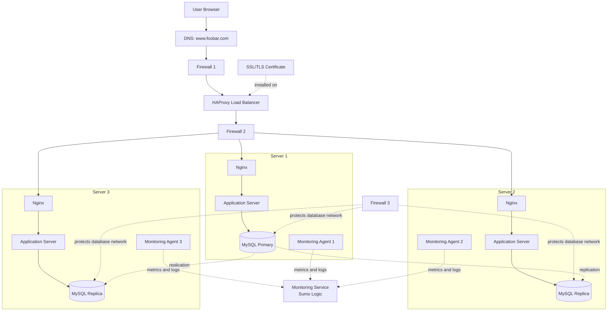

# 2. Secured and Monitored Web Infrastructure

## 1. Infrastructure Overview

This infrastructure hosts `www.foobar.com` using HTTPS. It includes one HAProxy load balancer, three servers, three firewalls, one SSL/TLS certificate, and three monitoring agents.

Each server contains an Nginx web server, an application server, application files, and a MySQL database component. The application servers work in an Active-Active setup, while the databases use a Primary-Replica replication setup.

## 2. How the Infrastructure Works

1. A user enters `www.foobar.com` in their browser.
2. DNS resolves the domain name to the public IP address of the load balancer.
3. The first firewall filters incoming network traffic.
4. HAProxy receives HTTPS requests and uses the SSL/TLS certificate to establish encrypted connections with clients.
5. HAProxy distributes requests across healthy application servers.
6. The other firewalls restrict traffic between internal components.
7. Nginx receives requests and forwards dynamic requests to the application server.
8. The application processes requests and communicates with MySQL.
9. The Primary database handles write operations and replicates changes to the Replica databases.
10. Monitoring agents collect system metrics and logs and send them to a monitoring service such as Sumo Logic.

##

**Note:** The diagram illustrates the main components and their relationships. In a production environment, firewall placement and routing must be configured to ensure that only authorized connections are allowed.

## 4. Why Each Additional Element Is Added

- **Three Firewalls:** They filter network traffic and block unauthorized connections. They protect the public entry point, internal servers, and database network.
- **SSL/TLS Certificate:** It enables HTTPS for `www.foobar.com`, encrypts traffic, and allows browsers to verify the website's identity.
- **Three Monitoring Agents:** Each agent collects data from one server, providing visibility into all three servers.
- **Monitoring Service:** A service such as Sumo Logic receives, stores, analyzes, and displays metrics and logs. It can also trigger alerts.
- **HAProxy Load Balancer:** It distributes incoming requests across healthy application servers.
- **Three Application Servers:** They increase application capacity and allow the application to continue operating if one server fails, provided health checks and routing are configured correctly.
- **MySQL Primary-Replica Replication:** It maintains copies of database changes on replica databases. Replicas can serve selected read queries and may help with recovery.

## 5. What Are Firewalls For?

A firewall controls incoming and outgoing network traffic based on security rules. It allows authorized connections and blocks unnecessary or unauthorized traffic.

Examples of firewall rules include:

- Allow HTTPS traffic on TCP port 443 to reach the load balancer.
- Allow the load balancer to connect only to the required web-server ports.
- Allow database connections only from authorized application servers.
- Block public access to MySQL ports.
- Restrict administrative access to approved sources.

Firewalls reduce the attack surface and help protect internal services from unauthorized access.

## 6. Why Is Traffic Served Over HTTPS?

HTTPS uses TLS to encrypt communication between a browser and the HTTPS endpoint.

HTTPS is important because it:

- Protects passwords, session cookies, and sensitive information while in transit.
- Helps prevent attackers from reading or modifying network traffic.
- Allows the browser to verify the website's identity using its certificate.

The certificate must be valid for `www.foobar.com`, must not be expired, and must be renewed before expiry.

HTTP requests should redirect to HTTPS where appropriate.

## 7. What Is Monitoring Used For?

Monitoring helps administrators understand the health, availability, and performance of the infrastructure.

It can track:

- CPU, memory, disk, and network usage.
- Web-server availability and HTTP errors.
- Application errors and response times.
- Database availability and replication lag.
- Request volume and server performance.

Monitoring alerts help the team detect failures and performance problems before they cause significant disruption.

## 8. How Does the Monitoring Tool Collect Data?

A monitoring agent, also called a data collector, runs on each server.

The agent can collect:

1. **System Metrics:** CPU usage, memory consumption, disk usage, and network activity.
2. **Web-Server Logs:** Nginx access logs, error logs, HTTP status codes, and request information.
3. **Application Data:** Application errors, exceptions, and response times.
4. **Database Metrics:** Database availability, active connections, query performance, and replication lag.

The agents send collected data to a monitoring service such as Sumo Logic over a protected connection.

The monitoring service stores and analyzes the data, displays dashboards, and evaluates alert rules.

The exact collection method depends on the monitoring product and the integrations that are configured.

## 9. How Can We Monitor Web Server QPS?

QPS stands for **Queries Per Second**. For a web server, it generally means the number of HTTP requests handled per second.

One way to monitor QPS is to collect request counters from Nginx using its status endpoint, an exporter, or access-log analysis.

The monitoring system calculates the rate of increase of the request counter over time.

For example, if a server handles 600 requests in 60 seconds:

`QPS = 600 / 60 = 10 requests per second`

A monitoring dashboard can display QPS over time and generate alerts when traffic becomes unusually high or low.

The metric should cover all relevant web servers. Any status endpoint must be protected from public access.

## 10. Issues With This Infrastructure

### 10.1 SSL Termination at the Load Balancer

When SSL/TLS terminates at HAProxy, traffic between HAProxy and the backend servers may be unencrypted unless TLS is also configured for internal connections.

This creates a security risk because someone who can access the internal network may be able to inspect sensitive traffic.

The load balancer also becomes a point where decrypted traffic and certificate private keys must be protected.

**Possible improvements:**

- Use HTTPS between HAProxy and backend servers when required.
- Restrict access to internal networks.
- Protect certificate private keys.
- Renew certificates before they expire.

### 10.2 Only One MySQL Server Can Accept Writes

If only the Primary database accepts writes, it becomes a potential bottleneck and a single point of failure for write operations.

If the Primary fails, write operations may become unavailable until it recovers or a Replica is promoted.

Replication alone does not guarantee automatic failover or prevent data loss.

**Possible improvements:**

- Configure and test a failover procedure.
- Monitor database health and replication lag.
- Maintain regular database backups.
- Prevent multiple databases from accepting conflicting writes during failover.

### 10.3 All Servers Have the Same Components

Having an Nginx web server, application server, and database on every server can make the infrastructure more difficult to maintain.

The database may compete with the application for CPU, memory, and disk resources. Running multiple database instances also increases the work required for backups, security, replication, and maintenance.

**Possible improvements:**

- Separate the application tier from the database tier when appropriate.
- Scale application servers independently from databases.
- Restrict database access to authorized application servers.
- Monitor each component separately.

### 10.4 Remaining Single Points of Failure

Even with three application servers, a single HAProxy load balancer can remain a single point of failure. If it fails, users may lose access to the application.

The Primary database can also interrupt writes if it fails.

**Possible improvements:**

- Use redundant load balancers with a failover mechanism.
- Monitor load-balancer and database health.
- Test database recovery and failover procedures.
- Maintain backups and document recovery steps.

## 11. Conclusion

This infrastructure improves security through firewalls and HTTPS and improves operational visibility through monitoring agents and a centralized monitoring service.

However, it is not automatically fully fault-tolerant. The load balancer and the write-capable Primary database may remain single points of failure.

Appropriate firewall rules, TLS configuration, monitoring alerts, database backups, and tested failover procedures are necessary for a secure and reliable infrastructure.
